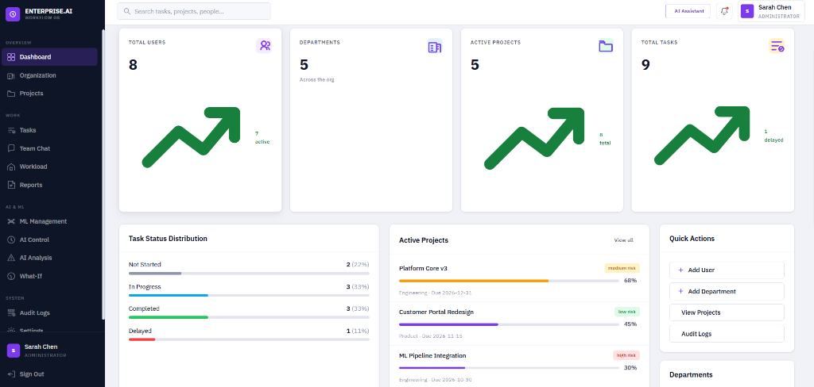
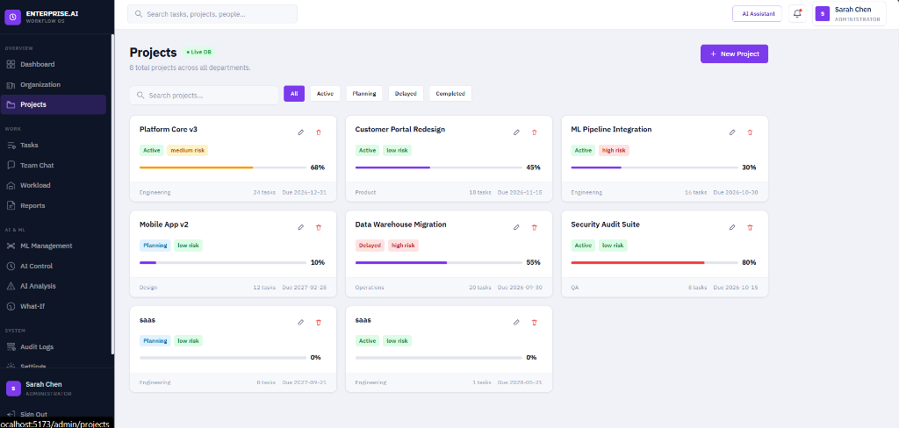
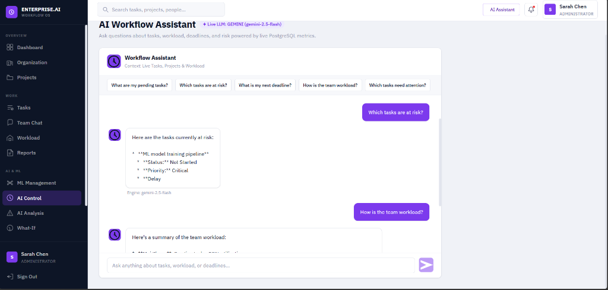
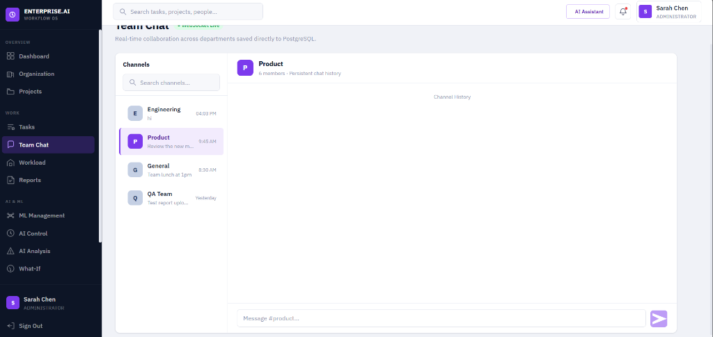
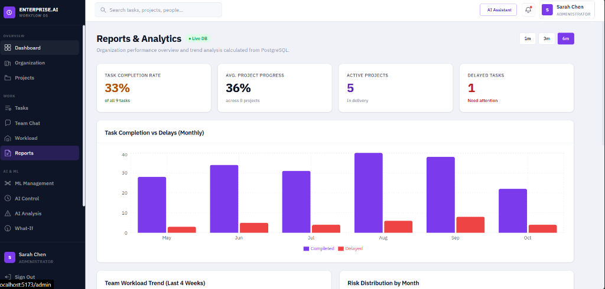
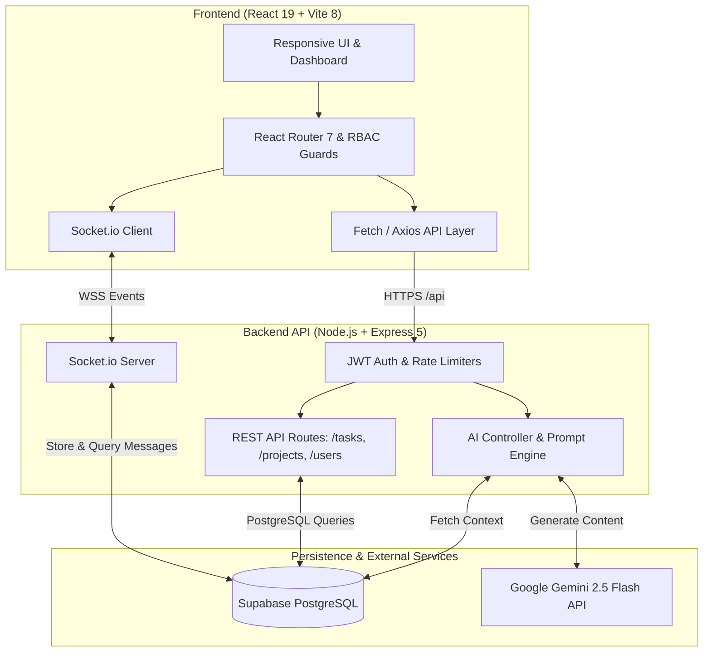

# Enterprise AI Workflow OS

> A modern, full-stack enterprise operations platform integrating role-based workflow coordination, real-time team collaboration, delivery risk intelligence, and conversational AI powered by Google Gemini.

---

## 📌 Project Overview

**Enterprise AI Workflow OS** is an operational workspace designed for cross-functional teams (Engineering, Product, Operations, QA). It unifies project tracking, task scheduling, capacity monitoring, and team messaging into a single interface.

The platform pairs operational PostgreSQL data with a conversational AI engine (powered by **Google Gemini 2.5 Flash**) and a predictive risk scoring engine. Managers and executives can query project health in natural language, detect bottlenecks before deadlines are breached, run "What-If" capacity simulations, and coordinate team members across role-specific dashboards.

---

## 📸 Screenshots

### 1. Operations & KPI Dashboard
Comprehensive real-time overview displaying active projects, task completion velocity, capacity metrics, and task distributions.


### 2. Project Portfolio Management
Portfolio tracking across departments with progress bars, delivery deadlines, and calculated risk indicators.


### 3. AI Workflow Assistant (Live LLM: Gemini 2.5 Flash)
Conversational assistant connected to live project and task records, providing natural-language answers and risk summaries.


### 4. Real-time Team Collaboration
Low-latency channel-based team communication powered by WebSocket (Socket.io) with message persistence in PostgreSQL.


### 5. Reports & Trend Analytics
Interactive charts evaluating monthly velocity, delay trends, and capacity distribution.


---

## ⚡ Main Features

* **Role-Based Access Control (RBAC):** Tailored views and permissions for **Administrator**, **Manager**, and **Employee** roles.
* **Portfolio & Project Management:** Track cross-department initiatives, delivery milestones, team leads, and risk tiers.
* **Task Scheduling & Tracking:** Priority tags (`Critical`, `High`, `Medium`, `Low`), status lifecycles, assignees, and real-time progress sliders.
* **Real-time Team Messaging:** Persistent multi-channel chatrooms using WebSockets (Socket.io) backed by Supabase PostgreSQL.
* **AI Workflow Assistant:** Direct conversational LLM integration powered by Google Gemini (`gemini-2.5-flash`), with contextual database awareness and a resilient local heuristic engine fallback.
* **Delivery Risk Assessment:** Automated delivery risk scoring and delay probability metrics calculated from task status, deadlines, and workload.
* **Workload & Capacity Tracking:** Employee workload breakdown and utilization heatmaps to prevent burnout.
* **Scenario Modeling (What-If Analysis):** Simulation interface to estimate deadline impact when resource allocations or scope shift.
* **System Audit Logging:** Complete administrative audit trail capturing logins, task creation, and data modifications.
* **Optimized Single-Page Application:** Route-level code splitting using `React.lazy()` and `Suspense`, compiled into 28 small vendor and route chunks (<1s build time).

---

## 🛠️ Technology Stack

| Layer | Technology | Details |
|---|---|---|
| **Frontend** | React 19, Vite 8, Tailwind CSS v4 | Modern SPA, component architecture, CSS variables design system |
| **Routing & State** | React Router 7, Context API | Protected role-based route guards, session persistence |
| **Data Visualization** | Recharts 3 | Responsive SVG area charts, bar charts, and utilization graphs |
| **Real-time Messaging** | Socket.io Client 4 | Low-latency bi-directional event bus for team channels |
| **Backend Runtime** | Node.js, Express 5 | RESTful API, structured routing, middleware architecture |
| **Security & Middleware** | Helmet, CORS, Rate-Limiting, Express-Validator | Defense-in-depth API hardening, brute-force mitigation |
| **Database** | PostgreSQL via Supabase | Relational data persistence, indexed foreign keys, audit logs |
| **Authentication** | JWT (`jsonwebtoken`), `bcryptjs` | Signed stateless tokens with configurable expiration |
| **AI / LLM Integration** | Google Gemini API (`gemini-2.5-flash`) | REST-based LLM inference with contextual system prompt injection |
| **Testing** | Jest, Supertest | Automated integration tests for Health, Auth, Tasks, and AI routes |

---

## 🏛️ System Architecture



---

## 📁 Repository Structure

```
Enterprise-AI-Workflow-OS/
├── backend/
│   ├── middleware/        # JWT auth verification, role-based access control
│   ├── routes/            # REST API route handlers (auth, tasks, projects, ai, chat)
│   ├── tests/             # Automated integration test suites (Jest + Supertest)
│   ├── db.js              # Supabase PostgreSQL client configuration & audit helper
│   ├── index.js           # Express application & Socket.io server bootstrap
│   ├── package.json       # Backend dependencies and test scripts
│   ├── supabase-schema.sql# Standalone PostgreSQL table schema and indexes
│   └── .env.example       # Documented backend environment template
├── docs/
│   └── screenshots/       # High-resolution application screenshots
├── src/
│   ├── components/        # Reusable UI primitives, AppShell, TopBar, Sidebar, Icons
│   ├── context/           # AuthContext and role permission state
│   ├── hooks/             # Custom data-fetching hooks (useApi, useMutation)
│   ├── pages/
│   │   ├── admin/         # Admin dashboards, Organization, Projects, Audit, What-If
│   │   ├── manager/       # Manager dashboard, Risk Analysis, Assistant
│   │   ├── employee/      # Employee dashboard, My Tasks, My Projects, Profile
│   │   └── shared/        # TasksPage, TeamChatPage, ReportsPage, LoginPage
│   ├── services/          # HTTP API client and Socket.io client singletons
│   ├── App.jsx            # Lazy-loaded routes with Suspense fallback
│   ├── main.jsx           # Application entry point
│   └── index.css          # Core design tokens, theme variables, and responsive layout
├── .env.example           # Safe frontend environment variable template
├── .gitignore             # Git exclusion rules for node_modules, build, and secrets
├── package.json           # Frontend dependencies and Vite build scripts
├── vercel.json            # SPA rewrite routing for frontend cloud deployment
└── vite.config.js         # Vite bundler configuration & vendor chunk code splitting
```

---

## 📋 Prerequisites

* **Node.js:** v18.0.0 or higher (v20+ recommended)
* **npm:** v9.0.0 or higher
* **Supabase Account:** Free project from [supabase.com](https://supabase.com)
* **Google AI Studio API Key (Optional for LLM features):** Free from [aistudio.google.com](https://aistudio.google.com)

---

## 🚀 Installation & Local Setup

### 1. Clone the Repository
```bash
git clone https://github.com/nagendrats254-jpg/Enterprise-AI-Workflow-OS.git
cd Enterprise-AI-Workflow-OS
```

### 2. Set Up the Backend
```bash
cd backend
npm install
```

Create your backend `.env` file from the example:
```bash
cp .env.example .env
```

Configure `backend/.env` with your values:
```ini
PORT=3001
NODE_ENV=development
JWT_SECRET=your-random-32-character-secret-key
JWT_EXPIRES_IN=7d

# Supabase Credentials (from Project Settings -> API)
SUPABASE_URL=https://your-project-id.supabase.co
SUPABASE_SERVICE_ROLE_KEY=your-supabase-service-role-key

# AI Configuration
AI_PROVIDER=gemini
AI_MODEL=gemini-2.5-flash
AI_API_KEY=your-google-ai-studio-api-key
```

### 3. Set Up the Database
1. Open your Supabase Dashboard.
2. Navigate to **SQL Editor**.
3. Copy the contents of `backend/supabase-schema.sql` and run it to create all tables (`users`, `tasks`, `projects`, `chat_channels`, `chat_messages`, `audit_logs`).

### 4. Set Up the Frontend
In a new terminal window at the repository root:
```bash
npm install
```

*(Optional)* Create a `.env.local` from `.env.example` if you need custom API endpoints:
```bash
cp .env.example .env.local
```

---

## 💻 Running Locally

### Start Backend Server (with hot reloading)
```bash
cd backend
npm run dev
```
The API server will start at `http://localhost:3001`.

### Start Frontend Application
```bash
# In the repository root
npm run dev
```
The React application will open at `http://localhost:5173`.

---

## 🧪 Running Automated Tests

The backend test suite validates system health, JWT authentication guards, task CRUD operations against PostgreSQL, and AI endpoint fallback resilience:

```bash
cd backend
npm test
```

Expected output:
```
PASS  tests/health.test.js
PASS  tests/auth.test.js
PASS  tests/tasks.test.js
PASS  tests/ai.test.js

Test Suites: 4 passed, 4 total
Tests:       20 passed, 20 total
Time:        ~35s
```

---

## 🔐 Demonstration Credentials

> **Notice:** The following accounts are intended exclusively for local evaluation and demonstration environments. Never use these credentials in a public production deployment.

| Role | Email | Password | Access Scope |
|---|---|---|---|
| **Administrator** | `admin@enterprise.ai` | `admin123` | Full system access, Organization management, What-If analysis, Audit logs |
| **Manager** | `manager@enterprise.ai` | `manager123` | Team projects, Task delegation, Risk analysis, Workload allocation |
| **Employee** | `employee@enterprise.ai` | `employee123` | Personal assigned tasks, My Projects, Personal workload, Profile |

---

## 🌐 API Reference

| Method | Endpoint | Description | Auth Required |
|---|---|---|---|
| `GET` | `/api/health` | Service health status and database mode | No |
| `POST` | `/api/auth/login` | Authenticate user and issue signed JWT | No |
| `GET` | `/api/auth/me` | Fetch active authenticated user profile | Bearer JWT |
| `GET` | `/api/tasks` | List tasks (filtered by user role) | Bearer JWT |
| `POST` | `/api/tasks` | Create task (admin / manager only) | Bearer JWT |
| `PATCH` | `/api/tasks/:id/status` | Update task lifecycle state | Bearer JWT |
| `DELETE` | `/api/tasks/:id` | Delete task | Bearer JWT |
| `GET` | `/api/projects` | List projects with progress and risk | Bearer JWT |
| `GET` | `/api/ai/status` | Report active LLM provider and model | Bearer JWT |
| `POST` | `/api/ai/chat` | Query AI assistant with context injection | Bearer JWT |
| `GET` | `/api/chat/channels` | Retrieve real-time messaging channels | Bearer JWT |
| `GET` | `/api/analytics/dashboard`| Aggregate KPI metrics across departments | Bearer JWT |

---

## ☁️ Production Deployment

### Frontend (Vercel)
1. Push the repository to GitHub.
2. Import the project into [Vercel](https://vercel.com).
3. Set the Root Directory to `./`.
4. Configure environment variables in the Vercel dashboard:
   * `VITE_API_URL`: `https://your-backend-api.onrender.com/api`
   * `VITE_SOCKET_URL`: `https://your-backend-api.onrender.com`
5. The included `vercel.json` automatically manages client-side SPA routing.

### Backend (Render / Railway)
1. Create a new **Web Service** on [Render](https://render.com).
2. Set the Root Directory to `backend`.
3. Set Build Command to `npm install`.
4. Set Start Command to `node index.js`.
5. Add environment variables:
   * `NODE_ENV`: `production`
   * `PORT`: `10000`
   * `JWT_SECRET`: `<secure-random-32-byte-string>`
   * `SUPABASE_URL`: `https://<your-project>.supabase.co`
   * `SUPABASE_SERVICE_ROLE_KEY`: `<your-supabase-service-role-key>`
   * `AI_PROVIDER`: `gemini`
   * `AI_MODEL`: `gemini-2.5-flash`
   * `AI_API_KEY`: `<your-google-ai-studio-key>`
   * `CLIENT_URL`: `https://your-frontend-app.vercel.app`

---

## 🔒 Security Best Practices

* **Zero-Secret Version Control:** All `.env` files and credentials are excluded from version control via `.gitignore`.
* **Privilege Isolation:** Service-role database keys and LLM tokens exist solely on the server; client bundles receive only sanitized JSON responses.
* **Input Validation:** Request payloads are checked using `express-validator` to prevent SQL/NoSQL injection and parameter pollution.
* **Header Hardening:** HTTP headers are secured using `helmet`.
* **Rate Limiting:** Global rate limiting (200 requests/15m) and strict authentication rate limiting (20 attempts/15m) prevent brute-force attacks.

---

## ⚠️ Known Limitations

* **Simulated ML Training Pipeline:** The ML Management section provides rule-based and simulated metrics; direct integration with PyTorch/TensorFlow training pipelines is in active design.
* **File Attachments in Chat:** Current messaging supports real-time text exchange; media and binary file uploads via S3/Supabase Storage are planned.
* **Multi-tenancy:** The current database schema supports single-tenant enterprise deployments.

---

## 🗺️ Roadmap & Future Enhancements

- [ ] Multi-tenant organization isolation (per-organization schema partitioning)
- [ ] Direct file attachments in real-time chat via S3/Supabase Storage buckets
- [ ] Webhook triggers for Slack and Microsoft Teams notification forwarding
- [ ] Exportable PDF and CSV reports for executive sprint retrospectives
- [ ] Real-time cursor presence and collaborative task editing

---

## 🤝 Contributing

Contributions, issues, and feature requests are welcome.
1. Fork the project.
2. Create your feature branch (`git checkout -b feature/AmazingFeature`).
3. Commit your changes (`git commit -m 'feat: add amazing feature'`).
4. Push to the branch (`git push origin feature/AmazingFeature`).
5. Open a Pull Request.

---

## 📄 License

This project is currently unlicensed. You are free to inspect the code for educational and evaluation purposes. A formal open-source license (such as MIT or Apache-2.0) may be selected by the repository owner.

---

## 👤 Author

* **Repository:** [nagendrats254-jpg/Enterprise-AI-Workflow-OS](https://github.com/nagendrats254-jpg/Enterprise-AI-Workflow-OS)
